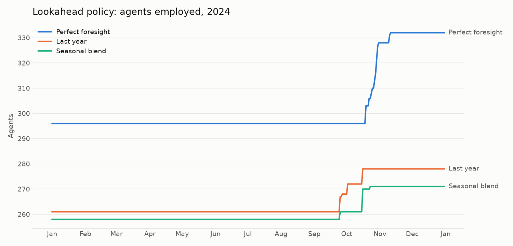
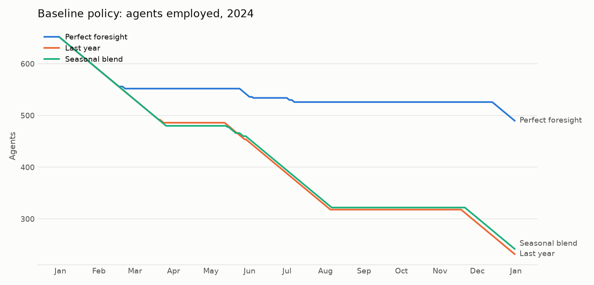
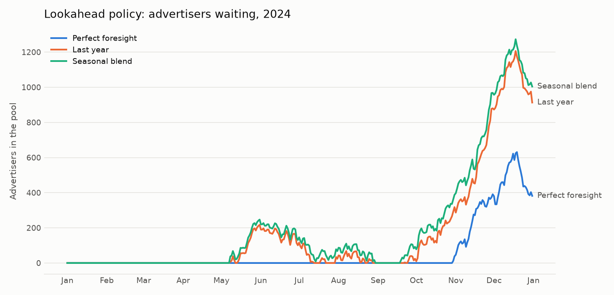
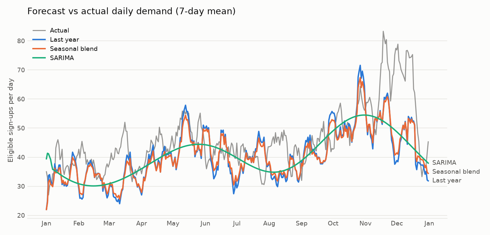

# Dynamic Agent Staffing for Google Ads

[](https://github.com/Atharv-R/dynamic-agent-staffing/actions/workflows/ci.yml)

A simulator, staffing policies and demand forecasters for deciding, day by day, how many
onboarding agents Google Ads should hire or fire. This began as a UC Berkeley IEOR × Google
case study (Spring 2025). This repository rebuilds the team's notebooks as a tested Python
package, fixes several modelling bugs, and reports the original and corrected results side by
side.

**Team (equal contribution):** Vedaant Agarwal, Atharv Raturi, Monika Voutov, Konstantin Zhivotov.
The original team repository, with the canonical notebook, is
[Dynamic-Agent-Staffing-Plan-Google-Ads](https://github.com/Dynamic-Agent-Staffing-Plan-Google-Ads/dynamic-agent-staffing-plan-google-ads),
and the poster is [docs/poster.pdf](docs/poster.pdf).

## The problem

Google gives eligible new advertisers (projected annual budget above a country threshold) 60
days of onboarding with a local agent. The rules:

- An agent supports at most **10 advertisers** at a time, each for **60 days**.
- **Hiring:** a new agent ramps up for 30 days before taking advertisers, and is paid from day one.
- **Firing:** 30 days' notice (paid) plus a penalty of **40% of annual salary**.
- Supporting an advertiser earns **13.5% of their projected annual budget**.
- Advertisers who wait 60 days without an agent leave the pool.

The objective is to maximise revenue uplift minus staffing costs by choosing daily hires and
fires. We model the USA (salary $77,721, 652 existing agents).

## Approach

### Simulation

```
 sign-ups ──► advertiser pool ──greedy, highest budget first──► agent pool (n × 10 slots)
              [budget, days waited]                              each slot = days until free
              leave after 60 days                                0 free · 60 just assigned
                                                                 30 for a new hire (ramp-up)
```

Each simulated day: sign-ups join the pool → the policy hires or fires → salaries are paid →
advertisers are assigned to free slots → slots count down → unassigned advertisers age out.
An agent can only be fired once all their advertisers finish within the 30-day notice period.

### Policies

- **Baseline:** if mean forecast demand over the next 60 days exceeds the training-year mean,
  hire `H` agents; otherwise fire up to `F`.
- **Lookahead:** let `D` be forecast demand over the next 30 days and `S` the number of slots
  that free up within 30 days. If `D > β·S`, hire `(D − β·S)/10` agents. If `S > α·D`, fire
  `(S − α·D)/10`. `α > 1` tolerates spare capacity because firing is expensive.

Parameters are tuned by grid search on 2023 with perfect foresight, then tested on 2024.

### Forecasting

All forecasters fit on data strictly before 2024. The package refuses to predict dates inside
the training history.

- **Seasonal naive:** last year's value for the same calendar day.
- **Seasonal blend:** the original "ARIMA". It was actually `0.8 × calendar-day mean + 0.2 ×
  trailing 30-day mean of its own forecasts`.
- **SARIMA:** a real seasonal ARIMA with weekly seasonality, Fourier terms for the annual cycle
  and AIC order selection (statsmodels).

## Results

### Original (real data, as reported)

| Setting | Profit |
|---|---|
| Baseline, tuned on 2023 with perfect foresight (H=13, F=3) | $206.0M |
| Lookahead, tuned on 2023 with perfect foresight (α=2.16, β=1) | $301.4M |
| Baseline, 2024, last year as forecast | $206.5M |
| Lookahead, 2024, last year as forecast | $282.4M |
| Baseline / Lookahead, 2024, "ARIMA" forecast | $292.7M / $294.5M |
| Poster headline | Baseline $207M, Lookahead $295M |

The "ARIMA" rows are not valid out-of-sample results (see below). The honest original numbers
are the "last year as forecast" rows.

### Corrected (real data)

<!-- Fill from `python scripts/run_experiment.py --data real` (aggregates only). -->
_Pending: run `python scripts/run_experiment.py --data real` on the case data._

### Synthetic-data demo

> These numbers come from the **synthetic** generator, not Google's data. They show the
> pipeline working; don't compare them with the real results above.

Corrected model, tuned on 2023 and tested on 2024:

| Policy | Forecast | Profit | Forecast MAE (sign-ups/day) |
|---|---|---|---|
| Baseline (H=0, F=2) | perfect foresight | $154.0M | 0 |
| Baseline | last year | $150.3M | 17.3 |
| Baseline | seasonal blend | $151.0M | 15.7 |
| Baseline | SARIMA | $151.8M | 12.1 |
| Lookahead (α=2.5, β=1.25) | perfect foresight | $163.5M | 0 |
| Lookahead | last year | $160.7M | 17.3 |
| Lookahead | seasonal blend | $159.8M | 15.7 |
| Lookahead | SARIMA | $159.9M | 12.1 |

On this data the policy matters more than the forecast. The lookahead policy beats the baseline
by $8–10M. The forecasters differ by under $1M, even though SARIMA's error is 30% lower than
last year's values. Both policies make coarse 30- or 60-day aggregate decisions, which average
away most daily forecast error.

| | |
|---|---|
|  |  |
|  |  |

## What changed and why

| # | Issue in the original notebooks | Fix |
|---|---|---|
| 1 | **Demand counted every sign-up**, eligible or not, while the budget was the eligible mean. Demand was overstated about 2.4x. | Demand is eligible sign-ups only. |
| 2 | **Forecast leakage.** The 2024 "ARIMA" forecast averaged each calendar day over 2023 *and 2024* actuals, and α was then tuned on 2024 itself. | Forecasters see only pre-2024 data and refuse in-sample dates. Tuning happens on 2023 only. |
| 3 | **Mislabelled "ARIMA"**: it was a seasonal blend. | Kept as `SeasonalBlend`; added a real SARIMA and seasonal naive, and compared them on MAE/MAPE and profit. |
| 4 | **Firing-loop bug.** When the lookahead rule computed 0 agents to fire, the loop's `count == fire` break never triggered, so it fired *every* fireable agent. | Fixed (`LookaheadPolicy(legacy=True)` reproduces it). |
| 5 | **Notebooks didn't run top to bottom**: stale variables, 2-vs-3 tuple unpacking, undefined `adv_waiting`, and a "feedback correction" whose assignment ratio was always 0. | One package, tests and a CLI. The feedback cells were dropped. |
| 6 | **Tuned values at the grid edge** (e.g. α=10.0 on a 1.1–10 grid). | Wider grids, and results flag any parameter that lands on an edge. |
| 7 | **Country values read by row position** (`agents.iloc[0,1]`). | Looked up by country name. |
| 8 | **One shared budget per day**, which made budget-sorted assignment meaningless. | Each advertiser keeps their own budget. Averaged mode is kept for reproduction. |
| 9 | **Two cost models**: the sensitivity cell charged an extra day of salary per hire. | One cost model in the simulator. |
| 10 | **Leap day** handled by copying Feb 28 by hand. | Calendar-day lookups map Feb 29 to Feb 28 when the history has no leap day. |
| 11 | **End-of-data truncation.** Near Dec 31 the lookahead window ran past the forecast and shrank, so the policy fired staff into the year end. | Forecasts extend 60 days past the test year. Perfect foresight is padded with last-year values past the end of the data. |

The ablation (`run_ablation`) applies the fixes one at a time and re-tunes after each. On
synthetic data, eligible-only demand accounts for most of the change in profit. Simulating the
full year with extended forecasts adds about $7M to the lookahead policy, mostly by avoiding
year-end firing.

**Perfect foresight is not a strict upper bound.** It gives the best possible forecast, but the
policies are heuristics, so a wrong forecast can occasionally make a luckier decision. Treat the
perfect-foresight rows as "what a perfect forecast buys", and the train/test rows as the honest
estimate.

## Reproducibility

`legacy` mode reproduces the original simulator exactly. `tests/test_legacy.py` runs the team's
`run_strategy` (copied verbatim) next to the package and requires identical profit and identical
daily agent and idle counts. On the real data,
`python scripts/run_experiment.py --data real` re-derives every original number in its first
table.

## Limitations and future work

- **Waiting advertisers are ignored by the policies.** `D` counts only future sign-ups, so a
  backlog never triggers hiring (see the waiting-pool chart). Adding the pool to `D` is the
  natural next step.
- **Assignment is greedy and immediate.** Holding some advertisers in the pool, within their
  60-day window, could avoid hiring for short peaks. Low-budget advertisers may not justify the
  cost of an agent at all.
- **Revenue is booked at assignment**, and there's no terminal value for staff at year end.
- **Single country.** Pooling agents across countries with shared languages and time zones
  (e.g. USA and Canada) could smooth capacity.
- **Seasonality-aware hiring cooldowns** (e.g. no firing within 4–6 months of a Q2/Q4 peak)
  would better reflect operations and morale.
- **Forecasts are fit once.** Re-fitting on a rolling origin as 2024 data arrives would be more
  realistic.

## How to run

```bash
python -m venv .venv && source .venv/bin/activate
pip install -e ".[dev]"

pytest                                   # tests, on synthetic data
python scripts/run_experiment.py         # synthetic data → results/synthetic/
python scripts/run_experiment.py --data real   # needs the CSVs in data/raw/
```

The case-study data is confidential and **not included**. To use it, place
`Advertiser Sign-ups.csv`, `Agent Salary and Eligibility Threshold.csv` and
`Existing Agent Staffing.csv` in `data/raw/` (gitignored). Without them, everything runs on a
seeded synthetic generator with the same schema, calibrated to the real aggregates: about 250k
sign-ups a year, about 42% eligible, and about 100 USA sign-ups a day.

Useful flags: `--model legacy`, `--policy lookahead`, `--forecaster seasonal_naive sarima`,
`--no-ablation`, `--no-plots`. Problem parameters and grids live in
[configs/default.yaml](configs/default.yaml). [notebooks/walkthrough.ipynb](notebooks/walkthrough.ipynb)
is a short guided tour.

## Repository layout

```
src/staffing/
  config.py       problem parameters and grids (from configs/default.yaml)
  data.py         real or synthetic data, eligibility, per-country daily series
  synthetic.py    seeded generator with the case-data schema
  forecast.py     SeasonalNaive, SeasonalBlend, SARIMA (out-of-sample only)
  simulation.py   agent/advertiser pools, costs, revenue, daily metrics
  policies.py     BaselinePolicy, LookaheadPolicy
  tuning.py       grid search with grid-edge reporting
  evaluate.py     train/test experiment, ablation, reproduction of the original
  plots.py        figures
scripts/run_experiment.py   CLI
tests/                      pytest suite (synthetic data)
notebooks/walkthrough.ipynb guided tour
legacy/                     the original notebooks, unchanged
docs/                       poster and README figures
```

## License

MIT. See [LICENSE](LICENSE). Copyright (c) 2025 Dynamic-Agent-Staffing-Plan-Google-Ads.
